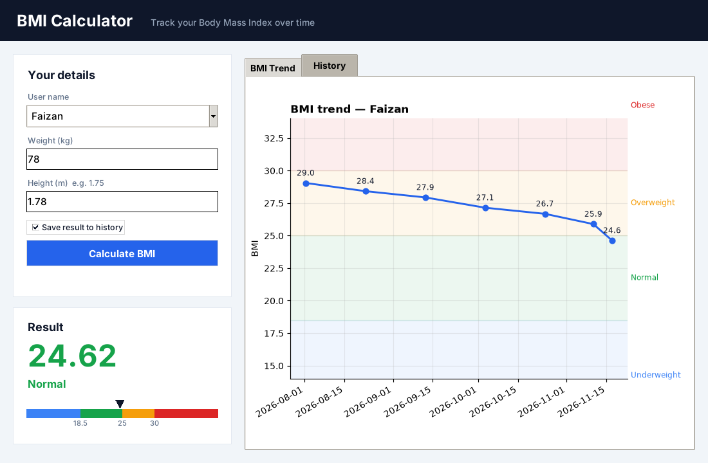
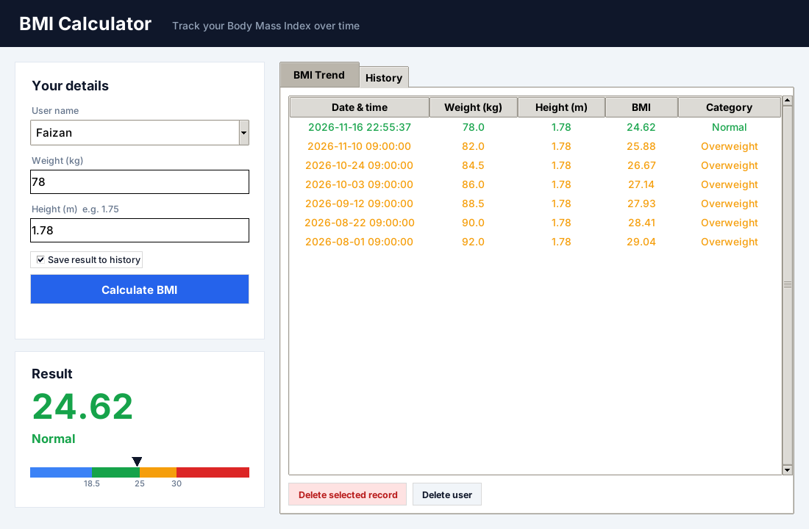

# BMI Calculator — Python (tkinter)

**Oasis Infobyte Internship (OIBSIP)** · Python Programming · Task 2 · **Advanced tier**
**Author:** Faizan Ali

A desktop app that calculates your Body Mass Index, shows which health category it falls in, and tracks the result over time for multiple users.



## Features

**Beginner tier**
- Weight (kg) and height (m) input
- BMI = weight / height², shown to 2 decimal places
- Categories: Underweight (< 18.5), Normal (18.5–24.9), Overweight (25–29.9), Obese (≥ 30)
- Input validation: empty, non-numeric, negative and out-of-range values are rejected with a clear message
- A command-line version is also included (`python bmi.py`)

**Advanced tier**
- tkinter GUI with labelled input fields and a **Calculate BMI** button (Enter key works too)
- Colour-coded result (blue, green, amber, red) plus a gauge that marks where the BMI sits on the scale
- Multi-user support: pick an existing user from the dropdown or type a new name
- History saved in a local SQLite database (`bmi_records.db`)
- **BMI Trend** tab: a matplotlib line chart of the selected user's BMI over time, with the category bands shaded
- **History** tab: every record in a table, with buttons to delete a record or a user
- Database errors are caught and shown in a dialog, so the app doesn't crash

## Screenshots

| History | Input validation |
|---|---|
|  |  |

## Tech Stack

Python 3 · tkinter · matplotlib · sqlite3

## Project Structure

```
Python-Task2-BMICalculator/
├── main.py           # tkinter GUI (run this)
├── bmi.py            # validation, BMI calculation, classification + CLI mode
├── database.py       # SQLite storage for users and records
├── test_bmi.py       # unit tests
├── requirements.txt
└── screenshots/
```

## How to Run

1. Install Python 3.9 or newer from [python.org](https://www.python.org/downloads/). On Windows, tick **"Add Python to PATH"** during setup. tkinter is included.
2. Install the dependency and start the app:

```bash
cd Python-Task2-BMICalculator
pip install -r requirements.txt
python main.py
```

Command-line version: `python bmi.py`
Run the tests: `python -m unittest test_bmi.py`

## How It Works

1. `parse_positive_number()` checks the input is a number within a realistic range (weight 2–500 kg, height 0.5–2.75 m). This catches mistakes such as typing 175 for height in metres.
2. `calculate_bmi()` applies the formula and rounds the result. `classify_bmi()` returns the category and its colour.
3. If **Save result to history** is ticked and a user name is entered, `BMIDatabase.add_record()` stores the result. User names are case-insensitive, so "Ali" and "ali" count as the same user.
4. The table and the chart reload from the database after every save or delete.

## Data & Privacy

All data stays on your computer in `bmi_records.db`. Nothing is sent over the network. Delete that file to clear all history.
