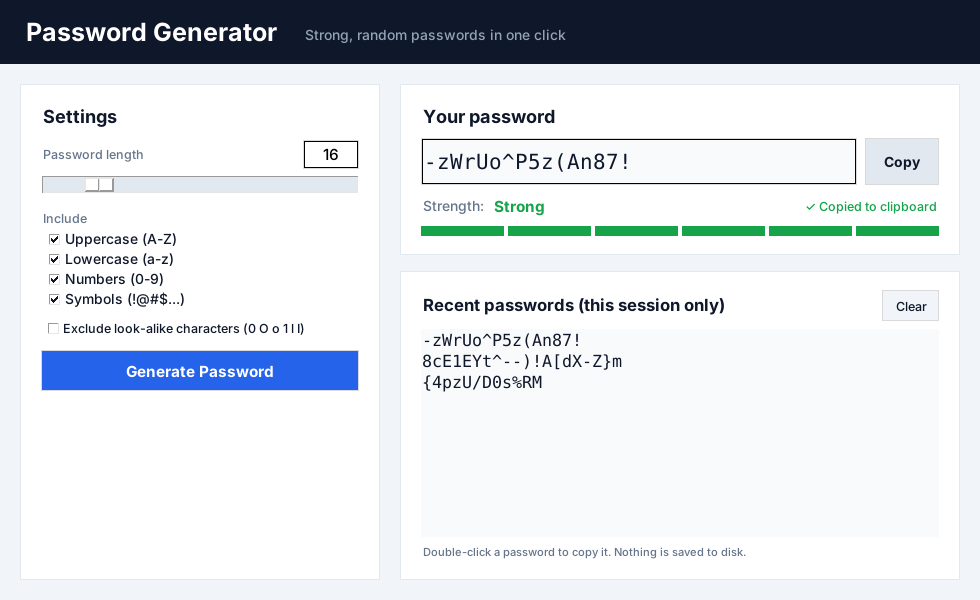
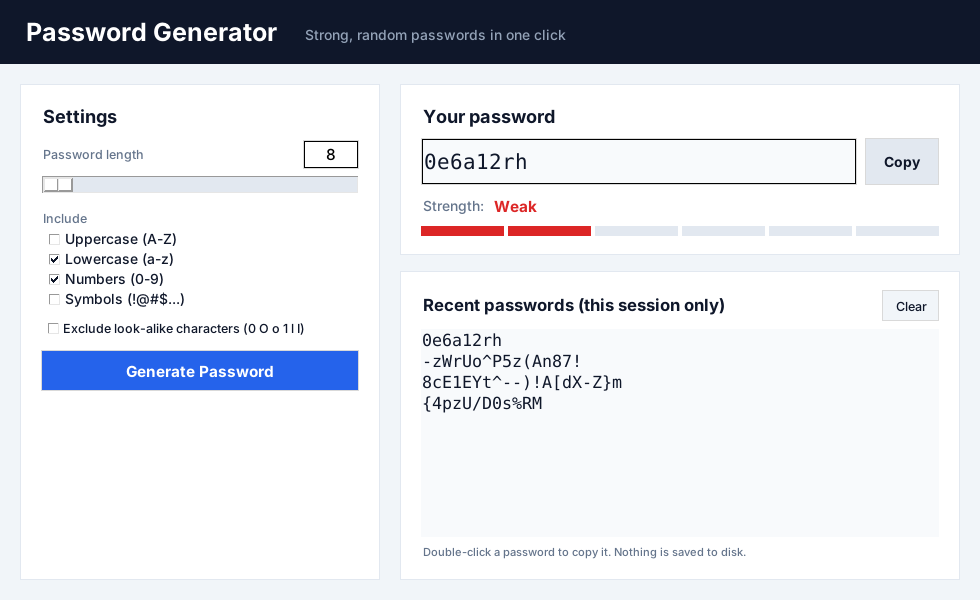
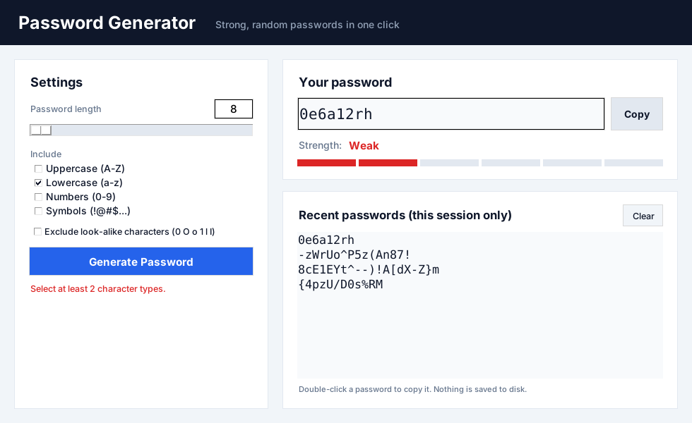

# Random Password Generator — Python (tkinter)

**Oasis Infobyte Internship (OIBSIP)** · Python Programming · Task 3 · **Advanced tier**
**Author:** Faizan Ali

A desktop app that creates strong, random passwords. You choose the length and the character types, see how strong the result is, copy it in one click, and keep the last 5 for this session.



## Features

**Beginner tier**
- Choose the password length (8–64 characters)
- Choose the character types: uppercase, lowercase, numbers and symbols (at least 2)
- Input validation with clear messages: empty, non-numeric, too short or too long, fewer than 2 types
- Generate again as many times as you like
- A command-line version is also included (`python generator.py`)

**Advanced tier**
- tkinter GUI with a length slider (kept in sync with a number box) and a checkbox for each character type
- Uses Python's **`secrets`** module (cryptographically secure), not `random`
- **Guarantees at least one character from every selected type.** It picks one from each type first, fills the rest from the combined pool, then shuffles securely.
- **Strength indicator:** Weak, Medium or Strong, with a 6-segment colour bar
- **Copy to clipboard** button
- **Exclude look-alike characters** option (`0 O o 1 l I |`)
- **Last 5 passwords** listed for this session only. They're kept in memory and never written to disk. Double-click one to copy it, or clear the list.

## Screenshots

| Weak password (8 chars, 2 types) | Validation |
|---|---|
|  |  |

## Strength Rule

| Check | Points |
|---|---|
| Length ≥ 12 | +1 |
| Length ≥ 16 | +1 |
| Each character type present (upper, lower, digits, symbols) | +1 each (max 4) |

**0–3 = Weak · 4–5 = Medium · 6 = Strong**

## Tech Stack

Python 3 · tkinter · secrets · string. Standard library only; nothing to install.

## Project Structure

```
Python-Task3-PasswordGenerator/
├── main.py             # tkinter GUI (run this)
├── generator.py        # validation, secure generation, strength + CLI mode
├── test_generator.py   # unit tests
├── requirements.txt    # no external packages
└── screenshots/
```

## How to Run

```bash
cd Python-Task3-PasswordGenerator
python main.py
```
On Windows, use `py main.py` if `python` doesn't work.

Command-line version: `python generator.py`
Run the tests: `python -m unittest test_generator.py`

## Design Notes

- **Why `secrets` and not `random`:** `random` is predictable and meant for simulations. `secrets` uses the operating system's secure random source, which is the right choice for passwords.
- **Why the guarantee matters:** if you pick characters only from the combined pool, a short password can miss a selected type completely (for example, no digit). The test suite generates 500 eight-character passwords and checks that every type appears in each one.
- **Clipboard:** tkinter's built-in `clipboard_append()` is used instead of `pyperclip`, so the app needs no extra install.
- **Privacy:** passwords exist only in memory and disappear when the app closes.
